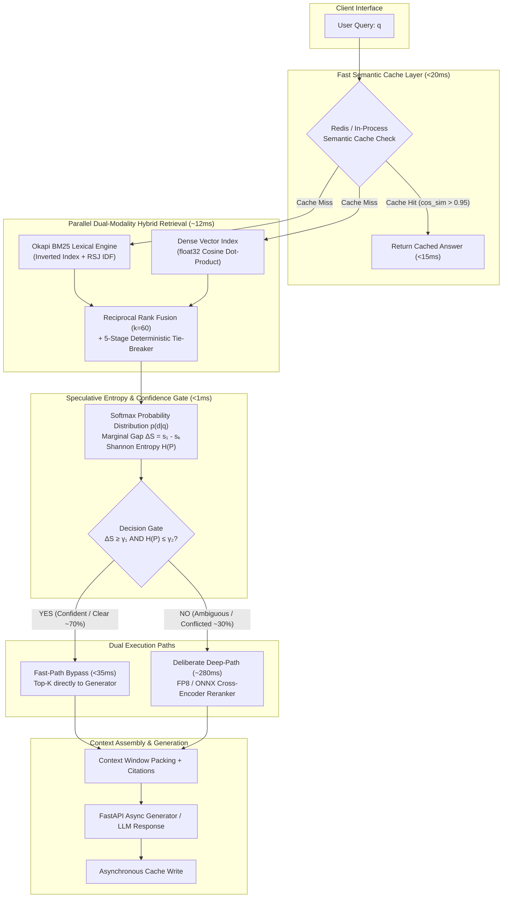

# SYSTEM ARCHITECTURE SPECIFICATION
## SpecRAG: Entropy-Gated Speculative Retrieval-Augmented Generation

```
========================================================================================
  Document Status : Living Architecture Blueprint (v1.0.0-rc1)
  Platform Scope  : Native Windows Python 3.12 | Zero-Docker Architecture
  Target Audience : ML Systems Engineers, Software Architects, & Autonomous Agents
========================================================================================
```

---

## 1. High-Level System Architecture

SpecRAG decouples retrieval into a **dual-speed speculative execution pipeline**:



---

## 2. Mathematical Formulations & Core Algorithms

### 2.1 Okapi BM25 Lexical Retrieval
Given a query $q$ composed of terms $\{t_1, t_2, \dots, t_m\}$ and a document chunk $d \in \mathcal{D}$:

$$\text{BM25}(q, d) = \sum_{i=1}^m \text{IDF}(t_i) \cdot \frac{f(t_i, d) \cdot (k_1 + 1)}{f(t_i, d) + k_1 \cdot \left(1 - b + b \cdot \frac{|d|}{\text{avgdl}}\right)}$$

Where:
- **Robertson-Spärck Jones IDF**:
  $$\text{IDF}(t_i) = \ln \left( \frac{N - n(t_i) + 0.5}{n(t_i) + 0.5} + 1 \right)$$
- $N$ is total document chunk count, $n(t_i)$ is number of chunks containing $t_i$.
- $k_1 = 1.5$ (term frequency saturation coefficient).
- $b = 0.75$ (document length normalization penalty).
- $\text{avgdl}$ is the average document chunk length across the collection.

### 2.2 Dense Vector Cosine Similarity
For normalized query embedding $\mathbf{q} \in \mathbb{R}^D$ and document embedding $\mathbf{d} \in \mathbb{R}^D$:

$$\text{CosineSimilarity}(\mathbf{q}, \mathbf{d}) = \frac{\mathbf{q} \cdot \mathbf{d}}{\|\mathbf{q}\|_2 \|\mathbf{d}\|_2} \quad \xrightarrow{\|\mathbf{q}\|=\|\mathbf{d}\|=1} \quad \sum_{j=1}^D q_j \cdot d_j$$

- **Implementation**: Vectorized in-memory NumPy matrix multiplication ($\mathbf{V} \mathbf{q}^T$) using SIMD-accelerated C-extensions.
- **Defensive Safeguards**: Vectors containing `NaN`, `Inf`, or zero-norms are intercepted and sanitized prior to dot product evaluation.

### 2.3 Reciprocal Rank Fusion (RRF)
Combines ranked candidates from both modalities into an integrated, bias-resistant ranking:

$$\text{RRF}(d) = \sum_{m \in \{\text{dense}, \text{sparse}\}} \frac{1}{k + r_m(d)}$$

- Default RRF constant: $k = 60$.
- **5-Stage Deterministic Tie-Breaker**:
  If two documents $d_A$ and $d_B$ share an identical RRF score:
  1. Primary: $\text{RRF\_Score}(d_A) \gtrless \text{RRF\_Score}(d_B)$
  2. Stage 2 (Consensus): $\text{modality\_count}(d_A) \gtrless \text{modality\_count}(d_B)$
  3. Stage 3 (Best Rank): $\min(r_{\text{dense}}, r_{\text{sparse}})_A \lessgtr \min(r_{\text{dense}}, r_{\text{sparse}})_B$
  4. Stage 4 (Raw BM25 Score): $\text{Score}_{\text{BM25}}(d_A) \gtrless \text{Score}_{\text{BM25}}(d_B)$
  5. Stage 5 (Lexicographical ID): $\text{chunk\_id}(d_A) < \text{chunk\_id}(d_B)$

### 2.4 Entropy & Dynamic Confidence Gating Policy (Milestone 2)
Given the top-$k$ retrieved candidates with normalized fusion scores $\mathbf{s} = [s_1, s_2, \dots, s_k]$ where $s_1 \ge s_2 \ge \dots \ge s_k$:

1. **Temperature-Scaled Softmax Distribution**:
   $$p(d_i | q) = \frac{\exp(s_i / \tau)}{\sum_{j=1}^k \exp(s_j / \tau)}$$
   *(Default temperature $\tau = 0.5$ to accentuate confidence peaks).*

2. **Marginal Score Gap**:
   $$\Delta S = s_1 - s_2$$

3. **Shannon Entropy (Uncertainty Metric)**:
   $$\mathcal{H}(P) = -\sum_{i=1}^k p(d_i | q) \log_2 p(d_i | q)$$
   $$\mathcal{H}_{\text{norm}}(P) = \frac{\mathcal{H}(P)}{\log_2 k} \in [0, 1]$$

4. **Routing Policy $\pi(q)$**:
   $$\pi(q) = \begin{cases} 
   \text{FAST\_PATH (Bypass Reranker)}, & \text{if } \Delta S \ge \gamma_1 \land \mathcal{H}_{\text{norm}}(P) \le \gamma_2 \\
   \text{CROSS\_ENCODER\_PATH (Rerank)}, & \text{otherwise}
   \end{cases}$$
   *(Empirically calibrated thresholds: $\gamma_1 = 0.15, \gamma_2 = 0.65$).*

---

## 3. Data Flow & Component Directory Structure

```text
D:\Ngoding\speculative-rag-engine/
├── docs/
│   ├── PRD.md                 # Product Requirements Document
│   ├── ARCHITECTURE.md        # This technical architecture document
│   └── CONTEXT.md             # Instant handover context for developers/agents
├── app/
│   ├── __init__.py
│   ├── config.py              # Central Pydantic v2 application configuration
│   ├── api/
│   │   ├── __init__.py
│   │   └── schemas.py         # Pydantic domain models (DocumentChunk, RetrievalResult)
│   ├── storage/
│   │   ├── __init__.py
│   │   ├── base.py            # Abstract BaseStorageRepository contract
│   │   ├── sqlite.py          # SQLite engine with float32 BLOB vector encoding
│   │   ├── postgres.py        # PostgreSQL 18.6 adapter with graceful fallback
│   │   └── vector_store.py    # NumPy in-memory dense vector index
│   ├── retrieval/
│   │   ├── __init__.py
│   │   ├── bm25.py            # Pure-Python Okapi BM25 implementation
│   │   ├── rrf.py             # Reciprocal Rank Fusion + 5-stage tie-breaker
│   │   └── hybrid.py          # Parallel asynchronous hybrid retrieval orchestrator
│   ├── core/                  # [Milestone 2 & 3 Target]
│   │   ├── entropy_gate.py    # Mathematical entropy & confidence router
│   │   ├── reranker.py        # ONNX Cross-Encoder wrapper
│   │   └── semantic_cache.py  # In-memory & Redis semantic cache
│   └── main.py                # FastAPI asynchronous application entrypoint
├── tests/
│   ├── conftest.py            # Shared fixtures, mock generators, and test DBs
│   ├── test_tier1_features.py # 43 baseline functional contract tests
│   ├── test_tier2_boundaries.py # 80 numerical & boundary edge-case tests
│   ├── test_tier3_combinations.py # 10 cross-modality permutation tests
│   ├── test_tier4_workloads.py # 10 throughput, concurrency, & volume tests
│   └── test_adversarial_m1_1.py # 37 stress tests (10k items, permutations)
├── benchmarks/
│   └── benchmark_ablation.py  # Automated Pareto Frontier benchmark script
├── run_tests.py               # Unified multi-runner test execution CLI
├── requirements.txt           # Minimal, verified Windows-native dependencies
└── README.md                  # Project landing page & quickstart
```

---

## 4. Storage & Persistence Layout

### 4.1 SQLite Storage (`app/storage/sqlite.py`)
- **Table Definition**:
  ```sql
  CREATE TABLE IF NOT EXISTS document_chunks (
      id TEXT PRIMARY KEY,
      text TEXT NOT NULL,
      metadata TEXT,             -- JSON encoded key-value pairs
      embedding BLOB,            -- Raw little-endian float32 binary array
      dimension INTEGER NOT NULL,
      created_at TIMESTAMP DEFAULT CURRENT_TIMESTAMP
  );
  ```
- **Serialization**: `np.array(vector, dtype=np.float32).tobytes()` ensures zero floating-point precision loss and constant-time $O(1)$ pack/unpack speed.

### 4.2 PostgreSQL Storage (`app/storage/postgres.py`)
- Connects directly to local PostgreSQL 18.6 on port 5432.
- Automatically creates matching table schema with parameterized queries.
- If PostgreSQL service is stopped or unreachable, system automatically degrades gracefully to SQLite/in-memory mode without raising fatal runtime exceptions.

---

## 5. Testing & Verification Infrastructure

The repository enforces a strict **4-Tier Testing Model** executed via `run_tests.py`:

```
┌─────────────────────────────────────────────────────────────┐
│                 TESTING TIERS (180 TESTS)                   │
├─────────┬───────────────────────────────────┬───────────────┤
│ Tier 1  │ Baseline Functional Features       │ 43 Tests      │
│ Tier 2  │ Boundary & Floating-Point Limits  │ 80 Tests      │
│ Tier 3  │ Cross-Modality Combinations       │ 10 Tests      │
│ Tier 4  │ High-Volume Stress & Workloads    │ 10 Tests      │
│ Advers. │ Permutation & Malformed Inputs    │ 37 Tests      │
└─────────┴───────────────────────────────────┴───────────────┘
```

Command to execute full suite:
```bash
python run_tests.py
```
*(Target: 180 passed in < 4.5 seconds on Windows native Python 3.12).*
